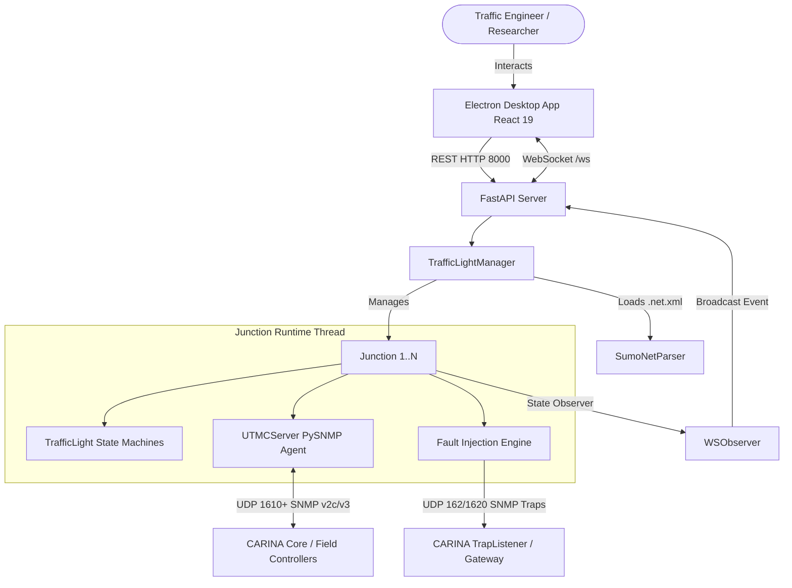

<!--
SPDX-FileCopyrightText: 2026 Noxfort Systems
SPDX-License-Identifier: Apache-2.0
-->

# 🏛️ CARINA Mock Lights: System Blueprint & Architecture

This document specifies the internal engineering architecture of **CARINA Mock Lights**. It details the multi-tiered concurrency model, SUMO network parser, UTMC2/SNMP responder engine, realistic controller presets, fault injection mechanisms, and the React + Vite + Electron desktop interface.

⬅️ Back to [Documentation Hub](docs/CARINA_MOC.md) | 🚦 See [Hardware Simulation](docs/HARDWARE_SIMULATION.md) | ⚡ See [API & Protocols](docs/API_REFERENCE.md)

---

## 1. Concurrency & Subsystem Topology

CARINA Mock Lights coordinates multiple concurrent engines within an integrated desktop runtime:

---

## 2. Core Subsystems

### 2.1 SUMO Network Parser (`core/sumo_parser.py`)
- **Direct XML Ingestion:** Parses standard Eclipse SUMO road networks in plain `.net.xml` or compressed `.net.xml.gz` formats using `xml.etree.ElementTree`.
- **Phase & State Extraction:** Discovers all `<tlLogic>` definitions, extracting phase durations, light state characters (`r`, `g`, `y`, `u`), and total signal link count per junction.
- **Topology Structuring:** Populates instances of `JunctionData` containing `PhaseData` sequences consumed by the manager.

### 2.2 Traffic Light State Engine (`core/traffic_light.py` & `core/manager.py`)
- **Discrete Signal Group States:** Models each signal head as an independent state machine (`RED`, `GREEN`, `YELLOW`, `OFF`).
- **Observer Pattern:** Subscribes asynchronous listeners (`LightObserver`, `WSObserver`) to notify external subscribers immediately on state mutation without polling.
- **Intergreen & Clearance Emulation:** Implements safety clearances during remote stage demands (`HOLD` / `FORCE_OFF`), guaranteeing a transition state (`YELLOW` clearance) prior to locking into the new requested stage.

### 2.3 Brazilian Controller Presets (`core/manager.py`)
Each junction automatically inherits a realistic hardware profile mapped by junction identity hash:
- **Dataprom DP-2000 & DP-SMART:** Brazilian ITS standard with UTMC2 v3.1 firmware.
- **Siemens ST950:** International controller with UTMC v4.2 profile.
- **Digicon CD-300:** Smart controller with UTMC2 OID support.
- **Swarco ITC-3:** High-performance European controller.
- **Kapsch EcoController:** Adaptive urban controller.

### 2.4 Asynchronous UTMC2 / SNMP Responder (`server/`)
- **PySNMP Asynchronous Agent (`server/utmc_server.py`):** Runs an isolated asyncio event loop in a dedicated background thread for each intersection, binding to UDP port `1610 + (port - 8080)`.
- **OID Handler Registry (`server/utmc_handlers.py`):** Routes incoming ASN.1 OIDs to dedicated command processors:
  - `HOLD` (`.2825.4.2.1.1.4.1.2.1`): Stage hold bitmask.
  - `FORCE_OFF` (`.2825.4.2.1.1.4.1.3.1`): Stage termination bitmask.
  - `OMIT` (`.2825.4.2.1.1.4.1.7.1`): Stage omit bitmask.
  - `EXTEND` (`.2825.4.2.1.1.4.1.6.1`): Phase green extension.
  - `DEMAND` (`.2825.4.2.1.1.4.1.5.1`): Traffic demand bitmask.
  - `FLASH` & `DARK` (`.2825.4.2.1.1.2.1.255.1` & `.254.1`): Flashing amber and lamp shutdown safety overrides.
  - `sysDescr` (`1.3.6.1.2.1.1.1.0`): Returns the controller brand and model description.
- **Simulated VPN Firewall:** Rejects SNMP packets originating outside private subnets (`10.0.0.0/8`, `127.0.0.0/8`, `192.168.0.0/16`, `172.16.0.0/12`).

### 2.5 Hardware & Software Fault Injection Engine (`core/manager.py`)
- Emulates realistic physical and software failure states.
- Assembles valid SNMPv2c Trap UDP packets using **BER/TLV** encoding and dispatches them to UDP `162` and `1620`.
- Categorized alarms:
  - **Hardware:** Lamp/LED failure (`LAMP_FAILURE`), Green-on-Green conflict (`GREEN_CONFLICT`), inductive loop failure (`DETECTOR_FAILURE`), power supply degradation (`POWER_ALARM`), cabinet open (`CABINET_DOOR`).
  - **Software:** Firmware rejection (`COMMAND_REJECTED`), clearance safety violation (`SAFETY_TIME_VIOLATION`), RTC drift (`RTC_DRIFT`), local timetable error (`PLAN_EXECUTION_ERROR`), request queue congestion (`QUEUE_OVERFLOW`).

### 2.6 Desktop User Interface (`ui/`)
- Built with **React 19**, **TypeScript**, **Material UI 9**, and **Vite**, packaged inside **Electron 42**.
- Connects to FastAPI via WebSockets for real-time visual updates of light states with zero render lag.
- Provides interactive switches for failure mode simulation, fixed plan override, and manual fault injection triggers.

---

## 3. Network Ports & Transport Overview

| Service | Protocol | Default Port | Description |
| :--- | :--- | :---: | :--- |
| **FastAPI REST API** | HTTP | `8000` | Junction management, network loader, manual triggers |
| **State Broadcasting** | WebSocket | `8000/ws` | Push notifications of light state changes |
| **UTMC2 SNMP Agent** | UDP | `1610+` | Per-junction SNMP responder (offset by junction index) |
| **SNMP Trap Sender** | UDP | `162, 1620` | Outgoing alarm notifications to CARINA |
| **Vite Dev Server** | HTTP | `5173` | React frontend development server |

---

   
  <b>Noxfort Systems</b> — <i>A State Of Art Company</i> 
  <i>Controlled Artificial Road-traffic Intelligence Network Architecture • CARINA MOCK LIGHTS v1.1.0</i> 
  <small>© 2026 Noxfort Systems • SPDX-License-Identifier: Apache-2.0</small>

