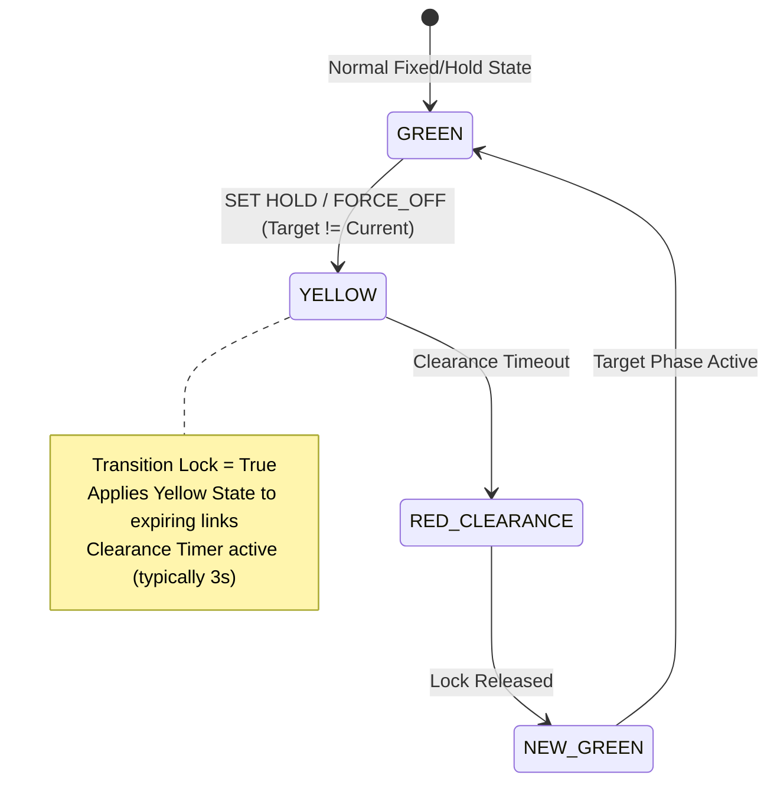

<!--
SPDX-FileCopyrightText: 2026 Noxfort Systems
SPDX-License-Identifier: Apache-2.0
-->


# 🚦 Hardware Simulation & Controller Presets

This document details how **CARINA Mock Lights** emulates physical traffic controller cabinets, including brand profiles, stage transition state machines, intergreen safety delays, and network firewall protection.

⬅️ Back to [Documentation Hub](CARINA_MOC.md) | ⚡ See [API & Protocols](API_REFERENCE.md) | ⚠️ See [Fault Injection](FAULT_INJECTION_ENGINE.md)

---

## 1. Controller Brand Profiles

To mirror real-world ITS field deployments, each junction in the simulator is assigned an authentic traffic controller brand and firmware profile based on a deterministic hash of the junction ID:

```python
BRAZILIAN_CONTROLLER_PRESETS = [
    {"brand": "Dataprom", "model": "DP-2000", "descr": "Dataprom DP-2000 Traffic Light Controller UTMC2 v3.1"},
    {"brand": "Siemens", "model": "ST950", "descr": "Siemens ST950 UTMC Traffic Controller v4.2"},
    {"brand": "Digicon", "model": "CD-300", "descr": "Digicon CD-300 Smart Traffic Controller UTMC2"},
    {"brand": "Swarco", "model": "ITC-3", "descr": "Swarco ITC-3 UTMC2 Traffic Controller"},
    {"brand": "Dataprom", "model": "DP-SMART", "descr": "Dataprom DP-SMART Traffic Controller UTMC2"},
    {"brand": "Kapsch", "model": "EcoController", "descr": "Kapsch EcoController UTMC2 Traffic Light System"},
]
```

### 1.1 `sysDescr` Query Response
When CARINA or an SNMP management system queries the standard MIB-II `sysDescr` OID (`1.3.6.1.2.1.1.1.0`), the responder returns the exact string associated with the controller model, enabling automatic hardware profiling by CARINA's `DriverFactory`.

---

## 2. Remote Stage Transitions & Intergreen Clearance

In real traffic cabinets, an immediate jump from Green to Red without an intermediate clearance phase is strictly prohibited to prevent intersection collisions. CARINA Mock Lights enforces realistic clearance sequencing during remote transitions:



### 2.1 Transition Mechanics
1. **Target Phase Assignment:** When an SNMP `SET` command arrives with a stage mask, `set_target_phase(phase_idx)` marks the requested stage.
2. **Clearance State (`YELLOW`):** Links transitioning from Green to Red display Amber for the designated clearance duration while `transition_lock` is held.
3. **Target Stage Activation:** Upon clearance expiration, the target stage lights turn Green, and the transition lock is released.
4. **Collision Safeguard:** Any additional incoming `HOLD` commands received while `transition_lock` is active are safely logged and queued, preventing rapid signal oscillations.

---

## 3. Operational Override Modes

A junction can be commanded into special operational modes via specific SNMP commands:

- **NORMAL:** Standard automatic cycle or coordinated remote AI stage execution.
- **ALERT (Flashing Yellow):** Triggered via OID `.2825.4.2.1.1.2.1.255.1`. All signal heads flash yellow at 1 Hz to notify drivers of an intersection alert or late-night mode.
- **OFF (Dark Mode):** Triggered via OID `.2825.4.2.1.1.2.1.254.1`. All signal heads are shut off (`OFF`), emulating full cabinet shutdown or emergency power-saving mode.

---

## 4. Simulated VPN Firewall Security

Real traffic controllers on municipal networks are shielded behind private VPN subnets (e.g. IPsec or WireGuard). CARINA Mock Lights implements a built-in subnet validator in [`server/utmc_responders.py`](../server/utmc_responders.py):

```python
is_secure = (
    source_ip.startswith("10.") or 
    source_ip.startswith("127.") or 
    source_ip.startswith("192.168") or 
    source_ip.startswith("172.")
)
```

If an SNMP packet arrives from an unverified public IP, the responder prints a firewall block warning, logs the event to `connections.log`, and immediately releases the state without processing the command, protecting the simulator from unauthorized external interference.

---

<div align="center">
  <br/>
  <b>Noxfort Systems</b> — <i>A State Of Art Company</i><br/>
  <i>Controlled Artificial Road-traffic Intelligence Network Architecture • CARINA MOCK LIGHTS v1.1.0</i><br/>
  <small>© 2026 Noxfort Systems • SPDX-License-Identifier: Apache-2.0</small>
</div>
