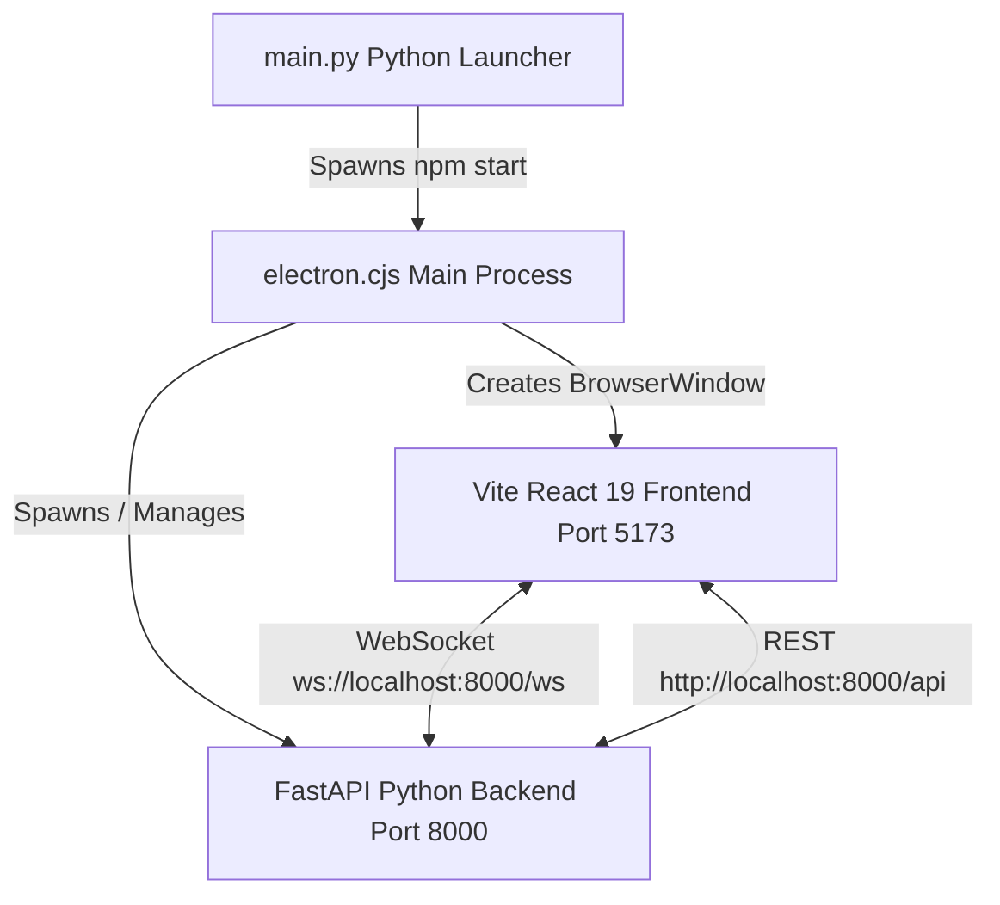

<!--
SPDX-FileCopyrightText: 2026 Noxfort Systems
SPDX-License-Identifier: Apache-2.0
-->

# 🖥️ UI & Electron Dashboard Architecture

This document specifies the technical architecture and component hierarchy of the **CARINA Mock Lights** desktop graphical user interface.

⬅️ Back to [Documentation Hub](CARINA_MOC.md) | 🏛️ See [System Architecture](ARCHITECTURE.md) | ⚡ See [API & Protocols](API_REFERENCE.md)

---

## 1. Technology Stack

The desktop interface combines modern web technologies with an Electron native window wrapper:

- **Electron 42:** Desktop window lifecycle management, multi-platform runtime (Linux/Windows), and backend child process management.
- **React 19:** Reactive user interface with functional components and hooks.
- **TypeScript 5.6:** Strict static typing for state and data transfer objects.
- **Material UI 9 (MUI):** Dark-mode enterprise component design system.
- **Vite 8:** Lightning-fast HMR (Hot Module Replacement) and production bundling.

---

## 2. Electron Process Model

### 2.1 Backend Process Lifecycle (`ui/electron.cjs`)
When `npm start` executes:
1. Vite spins up the development frontend on `localhost:5173`.
2. `electron.cjs` checks if the FastAPI backend is already running on port 8000.
3. If not running, Electron automatically launches `python main.py --server` as a child process.
4. When the Electron window is closed, child processes are cleanly terminated with `SIGINT`/`SIGTERM`.

---

## 3. React Component Architecture (`ui/src/App.tsx`)

### 3.1 State Synchronization Hooks
- **`useRef(WebSocket)`:** Maintains a persistent WebSocket connection to `ws://localhost:8000/ws`.
- **`onmessage` Handler:** Intercepts incoming `state_change` frames and mutates the React signal state in memory without incurring full component tree re-renders.

### 3.2 Visual Component Hierarchy
- **Header Toolbar (`AppBar`):**
  - Project branding with status indicator.
  - "Load SUMO Network" button triggering the native directory or file dialog.
- **Junction Grid (`Grid` / `Card`):**
  - **CardHeader:** Junction ID, Controller Brand/Model chip, and real-time connectivity status icon.
  - **SNMP Address Chip:** Clickable chip displaying the UDP host and port (e.g., `127.0.0.1:1610`) with one-click clipboard copy.
  - **Signal Head Array:** Live rendering of each signal link (colored circular indicators for `RED`, `GREEN`, `YELLOW`).
  - **Interactive Controls:**
    - `Simulate Failure`: Disconnects/drops the SNMP responder socket.
    - `Disable Fixed Plans`: Pauses local fixed-time cycles for external AI control.
    - `Simulate Hardware Fault`: Injects a random hardware failure trap.
    - `Simulate Software Fault`: Injects a random software failure trap.

---

## 4. Theme & Styling Guidelines

The application strictly implements the **Noxfort Dark Slate** visual palette:
- **Background Default:** `#0a0e17`
- **Surface / Paper:** `#111827`
- **Primary Cyan:** `#00e5ff`
- **Secondary Pink:** `#ff4081`
- **Green Active:** `#00e676`
- **Red Alert:** `#ff1744`
- **Amber Warning:** `#ffab00`

---

   
  <b>Noxfort Systems</b> — <i>A State Of Art Company</i> 
  <i>Controlled Artificial Road-traffic Intelligence Network Architecture • CARINA MOCK LIGHTS v1.1.0</i> 
  <small>© 2026 Noxfort Systems • SPDX-License-Identifier: Apache-2.0</small>

