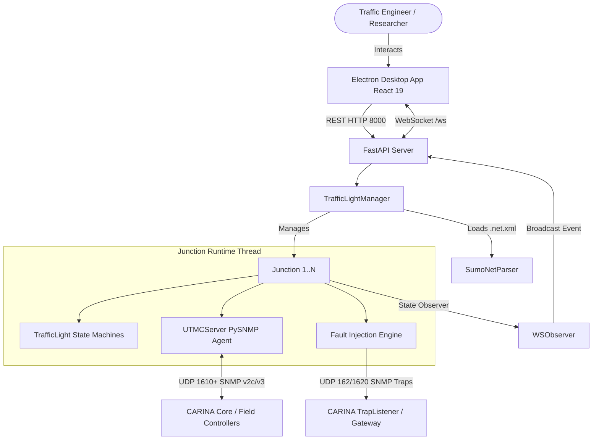

<!--
SPDX-FileCopyrightText: 2026 Noxfort Systems
SPDX-License-Identifier: Apache-2.0
-->

# 🏛️ CARINA Mock Lights: System Blueprint & Architecture

This document specifies the internal engineering architecture of **CARINA Mock Lights**. It details the multi-tiered concurrency model, SUMO network parser, UTMC2/SNMP responder engine, realistic controller presets, fault injection mechanisms, and the React + Vite + Electron desktop interface.

⬅️ Back to [Master MOC](carina_moc.md) | 🚦 See [Hardware Simulation](hardware_simulation.md) | ⚡ See [API & Protocols](api_reference.md)

---

## 1. Concurrency & Subsystem Topology

---

## 2. Core Subsystems

### 2.1 SUMO Network Parser (`core/sumo_parser.py`)
- Direct XML ingestion of `.net.xml` and `.net.xml.gz` files.
- Identifies `<tlLogic>` elements, phase dwell durations, light states, and link connectivity.

### 2.2 Traffic Light State Engine (`core/traffic_light.py` & `core/manager.py`)
- Independent signal head state machines (`RED`, `GREEN`, `YELLOW`, `OFF`).
- Observer pattern for instantaneous WebSocket and logging notifications.
- Intergreen clearance sequencing preventing instant Green-to-Red jumps during remote stage transitions.

### 2.3 Brazilian Controller Presets (`core/manager.py`)
- Automatic hardware emulation assignment: Dataprom DP-2000 & DP-SMART, Siemens ST950, Digicon CD-300, Swarco ITC-3, Kapsch EcoController.

### 2.4 Asynchronous UTMC2 / SNMP Responder (`server/`)
- Isolated PySNMP event loop per junction on UDP port `1610+`.
- Full command registry for `HOLD`, `FORCE_OFF`, `OMIT`, `EXTEND`, `DEMAND`, `FLASH`, `DARK`.
- Integrated VPN firewall restricting access to private subnets.

### 2.5 Hardware & Software Fault Injection Engine (`core/manager.py`)
- Catalog of physical and firmware failure scenarios.
- Pure Python BER/TLV binary SNMP Trap builder targeting UDP ports 162 and 1620.

---

   
  <b>Noxfort Systems</b> — <i>A State Of Art Company</i> 
  <i>Controlled Artificial Road-traffic Intelligence Network Architecture • CARINA MOCK LIGHTS v1.1.0</i> 
  <small>© 2026 Noxfort Systems • SPDX-License-Identifier: Apache-2.0</small>

