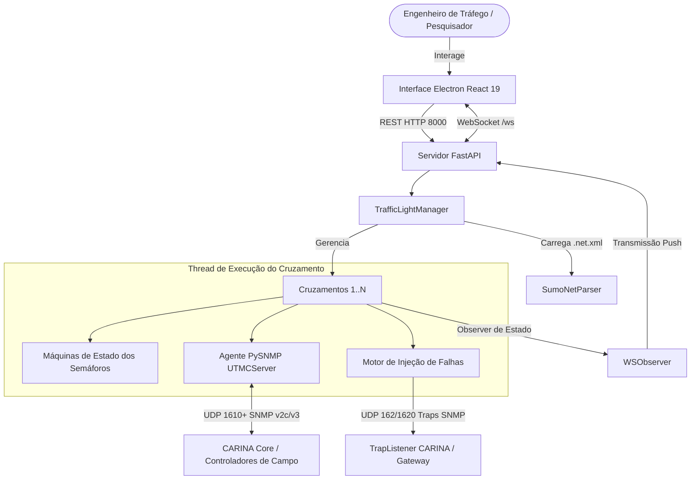

<!--
SPDX-FileCopyrightText: 2026 Noxfort Systems
SPDX-License-Identifier: Apache-2.0
-->

# 🏛️ CARINA Mock Lights: Blueprint e Arquitetura do Sistema

Este documento descreve a arquitetura interna do **CARINA Mock Lights**, detalhando o modelo de concorrência multithread, o parser de redes do SUMO, os respondedores UTMC2/SNMP, os presets de controladores reais e a interface Electron + React.

⬅️ Voltar para o [Master MOC](carina_moc.md) | 🚦 Ver [Simulação de Hardware](hardware_simulation.md) | ⚡ Ver [Referência de APIs](api_reference.md)

---

## 1. Topologia e Modelo de Concorrência

O CARINA Mock Lights orquestra múltiplos motores concorrentes integrados na mesma aplicação:

---

## 2. Subsistemas Centrais

### 2.1 Parser SUMO (`core/sumo_parser.py`)
- **Leitura Transparente:** Suporta arquivos de rede XML diretos (`.net.xml`) e comprimidos (`.net.xml.gz`).
- **Extração de Fases:** Analisa elementos `<tlLogic>`, extraindo tempos de permanência, códigos de estado dos focos (`r`, `g`, `y`, `u`) e contagem de ligações por cruzamento.

### 2.2 Motor de Estados Semafóricos (`core/traffic_light.py` e `core/manager.py`)
- **Grupos Focais Isolados:** Modela cada foco como uma máquina de estados discreta (`RED`, `GREEN`, `YELLOW`, `OFF`).
- **Interverdes e Segurança:** Implementa tempos de transição (amarelo de segurança) antes de travar um novo estágio remoto solicitado via comando SNMP.

### 2.3 Presets de Fabricantes Brasileiros (`core/manager.py`)
Cada cruzamento recebe automaticamente o perfil de um fabricante real por hash:
- **Dataprom DP-2000 e DP-SMART:** Padrão brasileiro com firmware UTMC2 v3.1.
- **Siemens ST950:** Controlador com perfil UTMC v4.2.
- **Digicon CD-300:** Controlador com suporte a OIDs UTMC2.
- **Swarco ITC-3:** Controlador europeu de alta densidade.
- **Kapsch EcoController:** Controlador adaptativo.

### 2.4 Respondedores UTMC2 / SNMP (`server/`)
- Executa um loop asyncio isolado por cruzamento na porta UDP `1610+`.
- Processa OIDs de controle de estágio (`HOLD`, `FORCE_OFF`, `OMIT`, `EXTEND`, `DEMAND`, `FLASH`, `DARK`) e identificação (`sysDescr`).
- Bloqueia requisições provenientes de fora de sub-redes privadas através de firewall de validação de IP.

### 2.5 Motor de Injeção de Falhas (`core/manager.py`)
- Emula incidentes físicos (LED queimado, conflito de verdes, laço indutivo rompido) e lógicos (rejeição de comando, violação de tempo, desvio de relógio RTC).
- Empacota mensagens BER/TLV nativas e despacha SNMP Traps para as portas UDP 162 e 1620.

---

   
  <b>Noxfort Systems</b> — <i>A State Of Art Company</i> 
  <i>Controlled Artificial Road-traffic Intelligence Network Architecture • CARINA MOCK LIGHTS v1.1.0</i> 
  <small>© 2026 Noxfort Systems • Licenciado sob Apache-2.0 • SPDX-License-Identifier: Apache-2.0</small>

